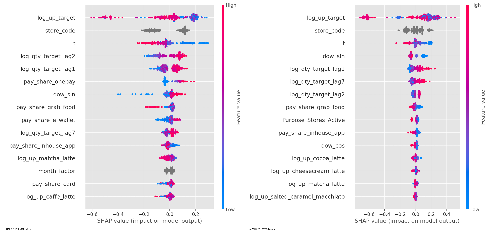
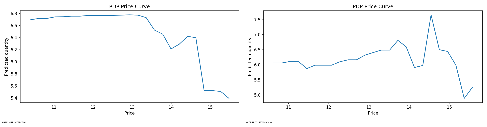
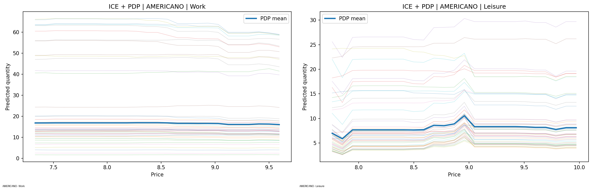

# Coffeehouse Demand Forecasting & Price Optimisation with CatBoost

**Machine Learning · Time-Series Analytics · Explainable AI · Revenue Optimisation**

> Can machine learning help a coffeehouse chain understand demand, account for different customer contexts, and identify better pricing strategies?

This project investigates beverage demand and pricing decisions for a coffeehouse chain in **Selangor, Malaysia**, using two years of transactional sales data. We combine **CatBoost demand forecasting** with **model interpretability and price optimisation**, while a complementary econometric analysis examines price elasticity.

Developed as a group research project for **MATH3068 – Mathematics Group Projects**, University of Nottingham Malaysia (**March 2026**).

## Project at a glance

| | |
|---|---|
| **Dataset** | 1,958,127 original sales transactions (2023–2024) |
| **Coverage** | 40 stores across 20 cities; 34 stores retained after data-quality and history filters |
| **Modelling focus** | 10 top-selling beverage products |
| **Machine learning** | 30 CatBoost models across pooled, Work and Leisure specifications |
| **Model selection** | Optuna (40 Bayesian trials per model) with chronological validation |
| **Explainability** | SHAP, Partial Dependence Plots (PDP), Individual Conditional Expectation (ICE) |
| **Optimisation** | Model-based revenue maximisation over observed price ranges |

## The business problem

A single pricing strategy may not work equally well for every store. A coffee purchased during a workday can be driven by different habits than one purchased during a leisure outing.

Our research investigates three questions:

1. **Demand:** How do price, promotions, timing and store characteristics relate to beverage sales?
2. **Segmentation:** Does training separate models for **Work** (office/university) and **Leisure** (shopping/commercial) store contexts improve demand predictions?
3. **Pricing:** What prices maximise *model-predicted revenue* for individual beverages within each segment?

The Work/Leisure labels reflect **store context**, not directly observed individual customer motivations.

## My contribution

**Leong Jun Chuen — Primary Contributor: CatBoost Machine Learning | Supporting Contributor: Data Cleaning & Feature Engineering**

My main responsibility in this group project was the **CatBoost machine learning component**, from model development through interpretation and price optimisation. I also **assisted the team with data cleaning and feature engineering**.

**Primary responsibility — CatBoost and machine learning**

- Developed **CatBoost regression models** to predict log-transformed beverage demand across pooled, Work and Leisure store segments.
- Conducted **hyperparameter tuning with Optuna**, using chronological validation to compare model performance.
- Evaluated predictive performance using **RMSE, MAE, R² and MAPE**, and compared segment-specific models against pooled models.
- Applied **SHAP, Partial Dependence Plots (PDP) and Individual Conditional Expectation (ICE)** to interpret model behaviour and demand sensitivity.
- Implemented **model-based price optimisation**, using predicted demand and a candidate-price grid to estimate revenue-maximising prices.

**Supporting contribution — Data preparation**

- Assisted with **data cleaning**, including checks for missing values, invalid prices and inconsistent product labels.
- Contributed to **feature engineering and preparation of modelling-ready data**, including store-level aggregation and time-, price- and demand-related predictors.

The dataset preparation, **log–log demand / 2SLS econometric analysis**, and final report formed part of the wider team's collaborative research. The responsibilities above describe my own contribution rather than sole ownership of the entire project.

## Data preparation and feature engineering

The source data covers **2023–2024** and includes product attributes, transaction dates, prices, discounts, store information and payment methods, supplemented by Malaysian public-holiday data.

Key preprocessing steps included:

- Consolidating transaction and public-holiday information.
- Treating missing values according to their meaning (e.g., milk/bean attributes are not applicable to every beverage).
- Removing zero/negative-price records and excluding stores with insufficient operating history.
- Standardising inconsistent product names.
- Aggregating transactions into store–product–day observations and preparing a wide store–date panel.
- Engineering **effective unit prices**, **lagged demand (1, 2 and 7 days)**, **weekly cyclical features**, **holiday/Ramadan indicators**, payment-method shares, and store/segment variables.

The final wide store–date panel contained **22,107 observations** (1,829 Work; 20,278 Leisure). These are *aggregated observations*, not raw transactions.

## Modelling approach

### 1. CatBoost demand forecasting

The prediction target is **log(sales quantity)** for each of the ten selected products. CatBoost was chosen for its ability to learn nonlinear feature relationships and handle categorical variables such as store IDs.

We compared:

- **Pooled models:** one model per product trained across Work and Leisure observations, with purpose-related features.
- **Segment-specific models:** separate models per product for Work and Leisure stores.

That gives **10 pooled + 10 Work + 10 Leisure = 30 trained model specifications**.

Hyperparameters were tuned with **Optuna's Tree-structured Parzen Estimator (TPE)**, using **40 trials per model**, **early stopping**, and a **chronological 80%/20% training–validation split by date**. GPU acceleration was used for training.

Model comparisons considered **RMSE, MAE, R² and MAPE**, with attention to metric scale (log quantity versus original quantity).

### 2. Explainable machine learning

- **SHAP:** identifies influential inputs and how they contribute to predictions.
- **PDP:** visualises average model-predicted demand as price changes.
- **ICE:** visualises how those price–demand relationships differ between individual observations.

These tools explain *model behaviour*; they do not, by themselves, establish causal price effects.

### 3. Revenue optimisation

For each product and store segment, we evaluated **40 candidate prices** between the **5th and 95th percentiles** of observed effective prices.

At each candidate price, the CatBoost model predicts demand, and estimated revenue is calculated as:

**Predicted revenue = Candidate price × Predicted quantity**

The candidate with the highest estimated revenue is selected. This is a **simulation-based recommendation**, not a measured increase in realised revenue.

### 4. Complementary statistical analysis

The wider project also estimated own-price and cross-price elasticities using **log–log demand models** and **two-stage least squares (2SLS)** with Hausman-style instrumental variables, providing an economic perspective alongside CatBoost's predictive approach.

## Key findings

**1. Segment-specific models improved Work-segment forecasting.**  Across all ten products, the Work-specific CatBoost models outperformed pooled models in the report's comparison, achieving an **approximately 29% average reduction in RMSE**. Leisure-segment results were more mixed.

**2. Separating customer contexts revealed important differences.**  Work locations exhibited more routine, weekday-oriented demand, while Leisure locations showed different temporal patterns and more varied price responses.

**3. Pricing recommendations differed for selected beverages.**  Three illustrative model-based optima are shown below:

| Beverage | Leisure price | Work price | Work vs Leisure |
|---|---:|---:|---:|
| Caffè Latte | RM 13.41 | RM 11.26 | −16.0% |
| Salted Caramel Macchiato | RM 16.91 | RM 15.63 | −7.6% |
| Pecan Crunch Latte | RM 14.65 | RM 13.36 | −8.8% |

For several other beverages, the estimated revenue-maximising prices were similar across the two contexts. All prices above are **model outputs**, not prices validated through live experiments.

## Original research figures

The visualisations below are **extracted from our research report**, not illustrative stock images. The complete collection is indexed in [`figures/FIGURES.md`](figures/FIGURES.md).

### SHAP: Hazelnut Latte (Work vs Leisure)

### Partial dependence: Hazelnut Latte (Work vs Leisure)

### ICE: Americano (Work vs Leisure)

More original figures: [Cheesecream Latte SHAP](figures/fig09_cheesecream_latte_shap.png) · [Cheesecream Latte PDP](figures/fig10_cheesecream_latte_pdp.png) · [Americano SHAP](figures/fig12_americano_shap.png) · [Americano PDP](figures/fig13_americano_pdp.png) · [full appendix galleries](figures/appendix/).

**Tabulated results:** [model comparison (Table 12)](results/selected_model_comparison_table12.csv) · [model-predicted optimal prices (Table 13)](results/revenue_optimal_prices_table13.csv) · [source notes and interpretation](results/FINDINGS.md).

## Tools and techniques

**Machine learning:** CatBoost, Optuna, regression, hyperparameter optimisation, temporal validation  
**Explainability:** SHAP, PDP, ICE  
**Data science:** Data cleaning, feature engineering, panel-data preparation, exploratory data analysis  
**Statistical research:** Price elasticity, log–log demand models, instrumental variables / 2SLS  
**Optimisation:** Grid search over candidate prices, revenue simulation

## Limitations and responsible interpretation

- The research uses **observational data**. Although the broader study uses an instrumental-variable approach for economic inference, **CatBoost price-response simulations should not be interpreted as causal effects**.
- Prices were optimised **one product at a time**, holding other product prices and features fixed. Results do not represent full-portfolio joint optimisation.
- The search was intentionally restricted to the historically observed price range; the model is not designed for reliable extrapolation outside that range.
- Predicted pricing gains have **not** been verified by an A/B test or real-world deployment.
- Some store segments have considerably fewer observations than others, so overfitting and sampling imbalance remain relevant concerns.

## Repository contents and reproducibility

This repository contains **original exported plots** under [`figures/`](figures/FIGURES.md) and **reported results as CSV** under [`results/`](results/FINDINGS.md). These artifacts are traceable to the team report (March 2026). The full modeling notebook can be uploaded separately after replacing any personal file paths and confirming rights to share.

The underlying transaction data may be subject to confidentiality restrictions. **Do not publish the original dataset without authorisation.** A permitted sample or synthetic dataset can demonstrate the pipeline if required. Without access to data, the plots and reported tables are auditable as report extracts but the complete model run is not reproducible from this package alone.

## Project team

**Leong Jun Chuen**, Lai Wan Yi, Larissa Chee Shuen Yuin, Michelle Alessandra and Tea En Qi  
University of Nottingham Malaysia · MATH3068 · March 2026

---

**Author:** [Leong Jun Chuen](https://github.com/Junchuenleong)  
**Focus:** Data science · Machine learning · Explainable AI · Applied pricing analytics
